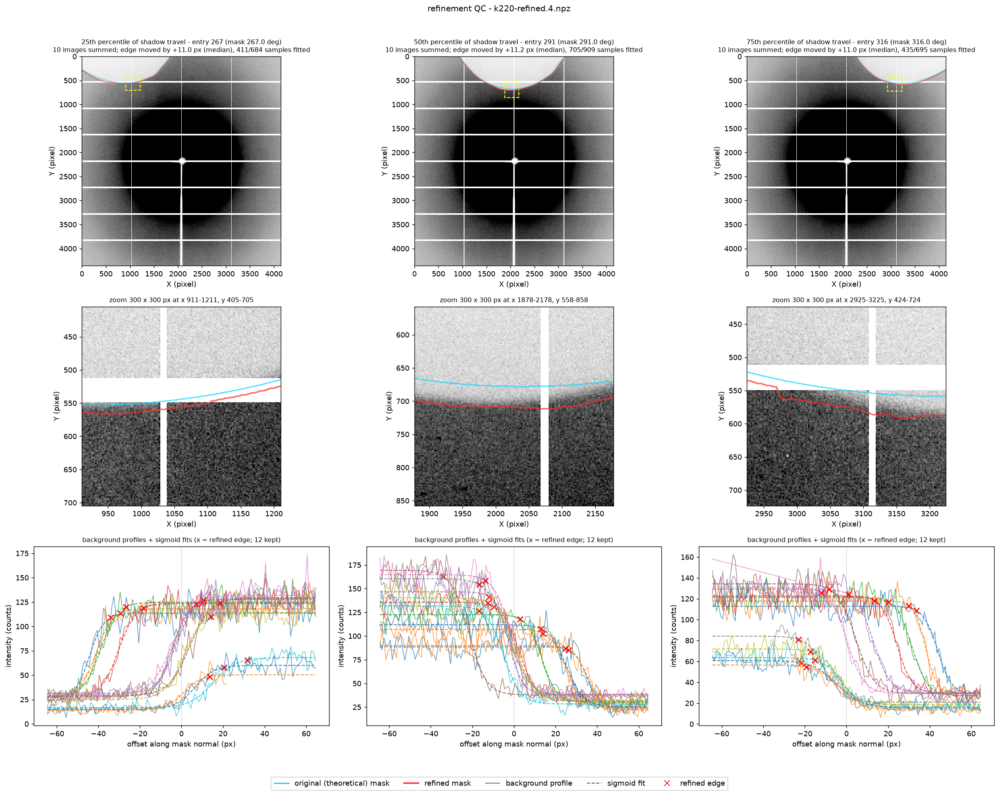
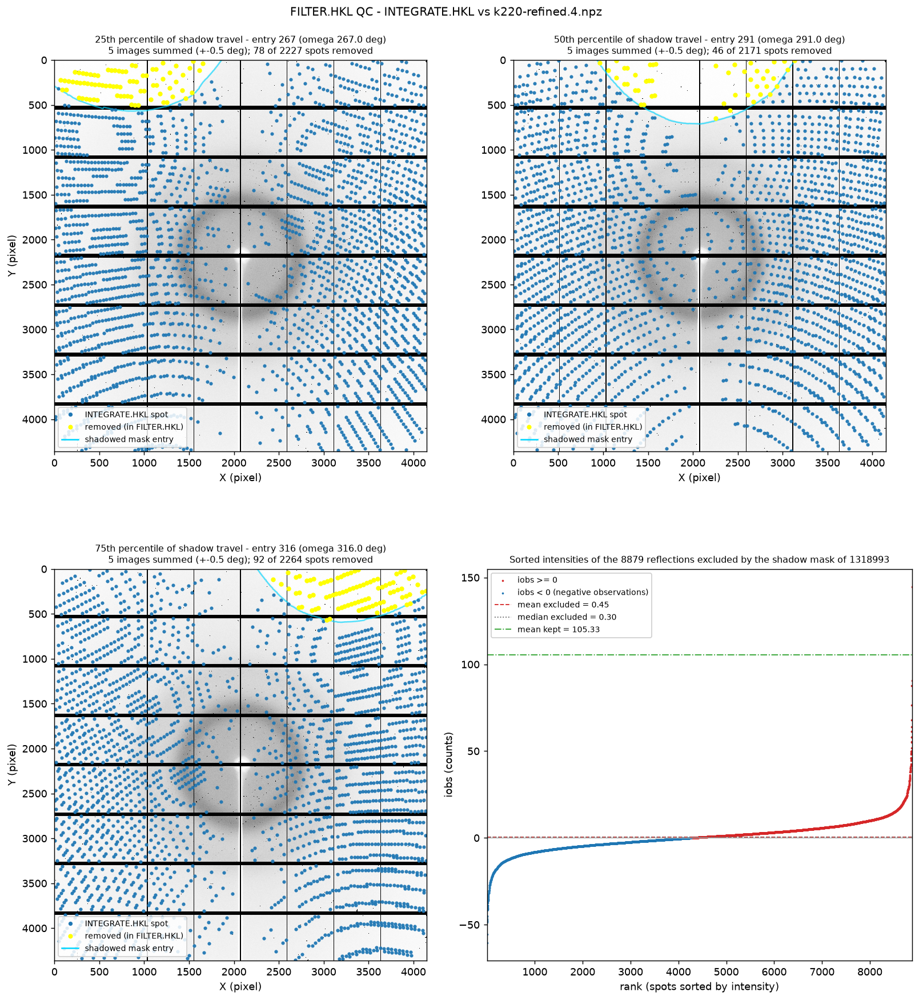

# xdsmask

Tools for handling the detector shadow cast by the sample pin and the phi arm
of a mini-kappa goniometer: visualise the shadow in the browser, refine the
theoretical shadow mask against the collected diffraction images, and exclude
the shadowed reflections from XDS.

## Why

On a mini-kappa goniometer the mounting pin and the phi arm sit in the beam
path and cast a moving shadow on the detector as omega advances. Reflections
that diffract into this shadow arrive attenuated (or not at all), which
distorts scaling and merging. XDS knows nothing about the shadow, so the fix
is to tell it exactly which reflections to ignore. XDS supports this natively:
place a `FILTER.HKL` next to the data and CORRECT ignores the listed
reflections.

This repository provides the three steps of that workflow:

| File | Role |
| --- | --- |
| `mini-kappa-goniometer-pin-shadow-visualizer.html` | Self-contained browser tool for the omega / kappa / phi geometry of a mini-kappa goniometer and the shadow the pin and phi arm cast on the detector; exports the shadow as a rotation-resolved theoretical mask (`.npz`, one entry per degree of omega). |
| `xdsmask_refine.py` | Refines the theoretical mask against the raw diffraction images: the shadow edge is moved to where the fitted low-to-high background transition actually lies. Also finds the rotation-angle offset, writes masked image copies and offers single-entry debugging. |
| `xdsmask_filter.py` | Reads `INTEGRATE.HKL`, looks every reflection up in the (refined) shadow mask and writes a `FILTER.HKL` that makes XDS ignore the shadowed reflections in CORRECT. |
| `example_output/` | Example QC figures produced by the two scripts, shown [below](#example-output). |

## Pipeline

1. **Theoretical mask.** The
   [visualizer webpage](mini-kappa-goniometer-pin-shadow-visualizer.html)
   draws the omega / kappa / phi three-circle geometry and the pin + phi-arm
   shadow for your beam / pin / detector parameters, and writes the shadow out
   as a theoretical mask: an `.npz` with boolean array `mask[omega_deg, row, col]`
   (`True` = shadowed, one entry per degree of the omega sweep), e.g.
   `mask_omscan_Eiger2X16M_k200.0.npz`.
2. **Angular offset.** The mask must first be aligned with the data in
   omega. `xdsmask_refine.py tune-offset` renders a figure to judge / tune the
   angle offset by eye (`--angle-offset`, plus orientation flags).
3. **Refine. `xdsmask_refine.py refine`** adapts the mask to reality: the
   shadow boundary is walked as a curve, the low-to-high background profile
   across the edge is fitted with a sigmoid from the raw images (aligned
   shift-and-add, so the 1-degree mask sampling and low backgrounds do not
   limit the fit) and the mask edge is moved to where the high plateau is
   reached. Result: a refined `.npz` with the same layout, a JSON report and a
   QC figure.
4. **Filter. `xdsmask_filter.py`** looks every reflection of
   `INTEGRATE.HKL` up in the refined mask (with a little play in omega and in
   x/y) and writes `FILTER.HKL`; re-run CORRECT and the shadowed reflections
   are ignored.

## Example output

Both scripts write a QC (quality-control) figure so the result can be judged
at a glance. The two below are the examples shipped in `example_output/`.

### Mask refinement QC (`example_output/refine_qc.png`)

Written by `xdsmask_refine.py refine` (default name `<masks-out>_qc.png`) for a
few representative mask entries. Three rows per entry:

* **top:** whole detector (binned) with the original mask outline (cyan)
  against the refined outline (red);
* **middle:** a full-resolution zoom around the middle of the refined edge,
  marked in the overview;
* **bottom:** the background profiles kept along the shadow boundary with
  their sigmoid fits and the refined edge position.

### FILTER.HKL QC (`example_output/filter_qc.png`)

Written by `xdsmask_filter.py` (default name `filter_qc.png`):

* three panels of diffraction images summed at the 25th / 50th / 75th
  percentile of the shadow travel, with the shadowed mask entry outlined
  (cyan), every `INTEGRATE.HKL` spot as a blue dot and every reflection that
  `FILTER.HKL` removes as a yellow dot;
* below them, the sorted-intensity (iobs) scatter of all excluded
  reflections, with the mean / median of the excluded spots and the mean of
  the kept spots for comparison.

## Install

Python 3 with NumPy is required; SciPy additionally for `xdsmask_refine.py`:

    pip install numpy scipy

Optional, depending on what you use:

    pip install matplotlib     # QC figures
    pip install fabio          # CBF images
    pip install h5py           # HDF5 images
    pip install imageio        # TIFF / PNG images (or pillow)

The visualizer is a single self-contained HTML file: just open it in a
browser, nothing to install.

## Usage

### 1. Write the theoretical mask

Open `mini-kappa-goniometer-pin-shadow-visualizer.html` in a browser, set the
motor positions and the beam / pin / phi-arm / detector parameters, and
download the rotation-resolved mask `.npz`. One set of motor positions drives
both views: a 3D goniometer view and the pin shadow on the detector face.

### 2. Find the angular offset

    python xdsmask_refine.py tune-offset INTEGRATE.HKL --images RAW_DIR --mask mask_omscan.npz --flip-vertical --flip-time --angle-offset 0.0 --out tune.png

Judge the offset from the figure and repeat with an updated `--angle-offset`
until mask and data agree. (`--images` accepts a directory, glob, `.txt` list or
single image; frame numbers are read from the file names.)

### 3. Refine the mask

    python xdsmask_refine.py refine INTEGRATE.HKL --images RAW_DIR --mask mask_omscan.npz --flip-vertical --flip-time --angle-offset 3.7 --masks-out refined.npz --report refine.json --jobs 4

Outputs `refined.npz` (same layout and orientation as the input mask, so the
same flags stay valid for it), a JSON `--report` of the per-entry statistics
and the QC figure.

### 4. Exclude the shadowed reflections from XDS

    python xdsmask_filter.py INTEGRATE.HKL refined.npz --images RAW_DIR -o FILTER.HKL --qc-image filter_qc.png

Copy `FILTER.HKL` into the XDS processing directory and re-run CORRECT; each
listed reflection is excluded with a small box around it (DX, DY, DZ, default
0.5). Pass `--no-qc-image` to skip the figure, `--omega-margin` (deg) and
`--xy-margin` (px) to control the play allowed when matching reflections to
the mask.

The same call from Python:

    from xdsmask_filter import make_filter_hkl
    res = make_filter_hkl("INTEGRATE.HKL", "refined.npz", "FILTER.HKL",
                          flip_vertical=True, flip_time=True, images="RAW_DIR",
                          qc_image="filter_qc.png")

### Helper subcommands (`xdsmask_refine.py`)

* `refine-debug`: refine a single mask entry against one or more images, in
  place, with a QC figure of the fit (`--grid-search` to sweep refinement
  parameters);
* `mask-images`: write copies of the raw images with the shadowed pixels set
  to the XDS bad-pixel value (default -1), e.g. for a visual check or for
  redoing SPOT INDEX with the shadow excluded.

## Notes

* **Geometry.** omega(z) = STARTING_ANGLE + OSCILLATION_RANGE * (z - (STARTING_FRAME - 1));
  the mask entry is omega mod 360 (one entry per degree). Values are taken from
  the `INTEGRATE.HKL` header, from `.lp` files, or overridden on the command
  line.
* **Orientation flags.** `--flip-vertical`, `--flip-horizontal`,
  `--transpose`, `--flip-time` and `--angle-offset` mean the same thing in both
  scripts; pass the same ones to both. `xdsmask_refine.py` detects a transposed
  mask automatically.
* **Large masks are streamed.** A 360-entry Eiger2X 16M mask is about 6.5 GB;
  the scripts read it one entry at a time and never load it whole.
* **Image formats.** `.npy`, `.npz`, `.h5`, `.cbf`, `.tif`, `.png`, transparently
  `.gz` / `.bz2` compressed (`xdsmask_refine.py`); one 2D frame per file.
